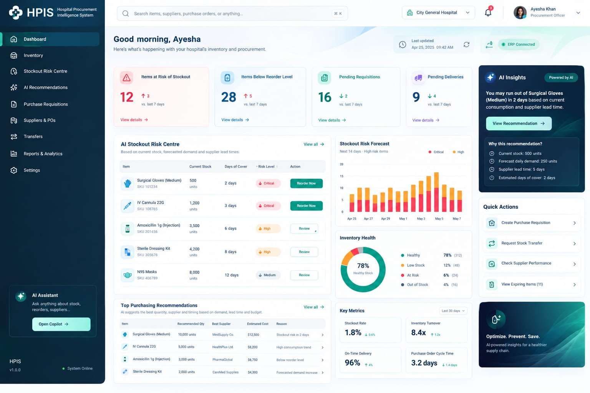

# MedNeurals – Frontend Implementation Plan

**Purpose:** a complete, phase-by-phase guide for building the React frontend with Claude Agent Mode. This file is
self-contained: the design, the backend API contract, the page specifications, the rules and ready-to-use prompts are
all here.

| **Item**            | **Status / decision**                                                                    |
|---------------------|------------------------------------------------------------------------------------------|
| Backend             | Phases 1–10 done (FastAPI + PostgreSQL). Read-only dashboard APIs available.             |
| Frontend folder     | `frontend/` exists and is empty (only this `docs/` folder).                               |
| Tooling available   | Node 24.19, npm 11.17                                                                     |
| Design reference    | `docs/design/dashboard-reference.jpg` (see §3)                                            |
| Authentication      | None yet (backend Phase 11). No login screen in this plan.                                |
| AI assistant        | Not available (backend Phase 12). Not in this plan.                                       |

*Design principle: the frontend only displays what the backend returns. It never calculates forecasts, probabilities,
reorder quantities, priorities or costs, and it never places orders. The system is advisory.*

---

# 1. Product context

MedNeurals is a decision-support system for the procurement officer of a Lahore tertiary-care hospital. It:

1. forecasts weekly demand for patient-care consumables per sub-store (ML, P50/P90, horizons H1–H4);
2. predicts the probability that a sub-store runs out of an item within 14 days (ML, risk URGENT / REVIEW / LOW);
3. recommends PURCHASE / TRANSFER / EXPEDITE_PO / NONE with HIGH / MODERATE / LOW priority (formulas and rules, saved in
   PostgreSQL);
4. shows supplier lead time, on-time rate and fill rate (statistics, no ML).

The frontend is the officer's dashboard over those saved results.

**Data facts (current database, useful for checking the UI):**
- 403 items, 11 stores (`STR-001` = Central Medical Store; `STR-002`…`STR-011` are sub-stores), 15 suppliers.
- Data up to `2025-11-30`. Latest prediction refresh: demand_forecast run **119** + stockout run **120**, models
  XGBoost 2.0 and HistGradientBoosting 2.0.
- Dashboard numbers today: 32 URGENT / 108 REVIEW / 263 LOW items; priorities 46 HIGH / 117 MODERATE / 240 LOW;
  193 items needing attention; 72 URGENT store×item rows; 462 recommendation rows.
- Good demo items: `MED-000222` (EXPEDITE_PO, open PO `PO2-009168`, URGENT at STR-004, probability 0.94) and
  `MED-000003` (PURCHASE 730 units).

---

# 2. Hard rules for the agent

1. **Inspect before editing.** Read this file and the existing `frontend/` code before every phase. Implement ONE phase
   at a time, only when asked. Do not start later phases early.
2. **Do not invent data or fields.** Use only the endpoints and fields in §6. If a design element has no backend data,
   follow §4 (replace or remove) – never hard-code fake numbers, trends, names or costs.
3. **No business calculations in the frontend.** Do not compute days of cover, estimated cost, reorder points,
   priorities or risk levels. Display persisted values. Allowed: formatting, sorting/grouping already-returned rows for
   charts (e.g. counting URGENT rows per store), percentages of returned counts.
4. **Advisory only.** No button places a purchase order or changes a recommendation. Action buttons navigate.
5. **Do not modify the backend.** Backend changes (CORS, new endpoints) need explicit approval. Use the Vite proxy (§5.3).
6. **Keep it simple.** Only the libraries in §5.1. UI components come from **shadcn/ui** (added with its CLI, then
   styled). No other UI kit, no state-management library (TanStack Query is enough), no SSR.
7. **JavaScript + JSX only.** No TypeScript: components are `.jsx`, other modules `.js`. Response shapes are in §6.13;
   document them with JSDoc `@typedef` in `src/api/shapes.js` and follow them exactly.
8. **Every data view has loading, empty and error states** (§7.4).
9. **Responsive:** must work from 360 px phone width to 1600 px desktop, no horizontal page scroll.
10. **Report at the end of every phase:** files changed, commands to run, what was verified in the browser and what
    was not.

---

# 3. Design reference



File: `docs/design/dashboard-reference.jpg`. Match its **layout, visual style, spacing and component look**. Its
**data, labels and some widgets** are placeholders and must be adapted to MedNeurals as described in §4.

## 3.1 Layout (desktop ≥ 1280 px)

```
┌──────────────┬──────────────────────────────────────────────────────────────────────────────┐
│              │ Header: search bar ........................ DB status pill · (no bell/user)   │
│   Sidebar    ├──────────────────────────────────────────────────────────────────────────────┤
│  (dark teal) │ Greeting + subtitle                         "Last updated" card + reload icon │
│              ├───────────┬───────────┬───────────┬───────────┬──────────────────────────────┤
│  logo        │ KPI card  │ KPI card  │ KPI card  │ KPI card  │  Recommendation spotlight     │
│  nav items   ├───────────┴───────────┴─────┬─────┴───────────┤  (dark teal card)             │
│              │ Stockout Risk Centre table  │ Risk by store   ├──────────────────────────────┤
│              │ (top 5)                     │ stacked bars    │  Quick actions                 │
│              │                             ├─────────────────┤                                │
│              │                             │ Risk mix donut  │                                │
│              ├─────────────────────────────┼─────────────────┼──────────────────────────────┤
│  status +    │ Top purchase recommendations│ Prediction run  │  Decorative banner             │
│  version     │ (top 5)                     │ card            │                                │
└──────────────┴─────────────────────────────┴─────────────────┴──────────────────────────────┘
```

- Grid: sidebar ~272 px fixed; main content 12-column grid with ~24 px gaps; right column ~280 px.
- Tablet (768–1279 px): right column moves below the main content; KPI cards in 2×2.
- Phone (< 768 px): sidebar becomes a slide-in drawer opened from a menu button; everything stacks in one column; tables
  scroll horizontally inside their card only.

## 3.2 Visual style (approximate values taken from the design – tune by eye against the image)

| Token                | Value (approx.)            | Used for                                                    |
|----------------------|----------------------------|-------------------------------------------------------------|
| `--sidebar-bg`       | gradient `#0B3442 → #0A2A36` | Sidebar background                                        |
| `--sidebar-active`   | `#12505C`                  | Active nav item background (rounded, full width)            |
| `--sidebar-text`     | `#E6F1F3` / muted `#9DB8BF`| Nav labels / secondary text                                 |
| `--page-bg`          | `#F5F8FA`                  | Main background (subtle light gradient top-right is optional)|
| `--card-bg`          | `#FFFFFF`                  | Cards; border `#E6ECF0`, radius 12 px, very soft shadow     |
| `--text`             | `#0F2A37`                  | Headings and numbers                                        |
| `--text-muted`       | `#64748B`                  | Subtitles, table headers                                    |
| `--primary`          | `#0F766E`                  | Primary buttons ("Reorder Now" style), links                |
| `--accent`           | `#5EEAD4` → `#99F6E4`      | Light-mint button on dark cards ("View Recommendation")      |
| `--danger` / URGENT / HIGH | `#E11D48`, bg `#FFE4E6` | Critical badges, URGENT bars                         |
| `--warning` / REVIEW / MODERATE | `#F59E0B`, bg `#FEF3C7` | High/review badges, REVIEW bars               |
| `--success` / LOW    | `#10B981`, bg `#D1FAE5`    | Healthy/low-risk, donut main segment                        |
| `--info`             | `#3B82F6`, bg `#DBEAFE`    | Neutral icons (KPI 2)                                       |
| `--violet`           | `#8B5CF6`, bg `#EDE9FE`    | KPI 4 icon                                                  |

- Font: **Inter** (Google Fonts), weights 400/500/600/700. Big KPI numbers ~36 px semibold; card titles 16 px semibold;
  table text 13–14 px.
- KPI card: rounded icon tile (40 px, tinted background) top-left, title right of it, big number, small caption, and
  a "View details →" link at the bottom. The first KPI card has a red-tinted border/background like the design.
- Badges: pill shape, tinted background, small icon + text (e.g. `▲ Critical`).
- Icons: lucide-react line icons (shadcn's default icon set), 18–20 px.
- Implementation: put these tokens in `src/index.css` as CSS variables and map them onto the shadcn theme variables
  (`--background`, `--card`, `--primary`, `--destructive`, `--sidebar*`, `--chart-1…5`, `--radius: 0.75rem`) plus custom
  ones (`--warning`, `--success`, `--info`, `--violet`) exposed to Tailwind with `@theme inline`. Restyle shadcn
  components through these variables and Tailwind classes; do not fork their logic.
- Dark cards (spotlight, banner): teal gradient `#0E3A47 → #0B5560`, white text, mint button.

## 3.3 Branding changes

- Logo text **"MedNeurals"** with subtitle "Procurement Decision Support" (replaces "HPIS / Hospital Procurement
  Intelligence System"). Use a simple lucide icon (e.g. `Cross` or `Activity`) in the logo tile.
- Greeting: **"Good morning" / "Good afternoon" / "Good evening"** by local time – no user name (no login yet).
- Subtitle: "Here's the latest forecast, stockout risk and procurement advice for your hospital."

---

# 4. Design → MedNeurals mapping (what each design element becomes)

Every element is either backed by a real endpoint or replaced/removed. **Nothing is faked.**

| Design element                         | MedNeurals version                                                                                     | Data source                                                         |
|----------------------------------------|---------------------------------------------------------------------------------------------------------|---------------------------------------------------------------------|
| Header search                          | Product search with typeahead (debounced 300 ms, top 8); selecting opens Product Analysis               | `GET /products?search=…&limit=8`                                    |
| Hospital selector                      | **Remove** (single hospital, no endpoint)                                                               | –                                                                   |
| Notification bell                      | **Remove** (no endpoint)                                                                                | –                                                                   |
| User avatar "Ayesha Khan"              | **Remove** (no auth until Phase 11)                                                                     | –                                                                   |
| "Last updated Apr 25…" + reload icon   | "Predictions updated" = `latest_prediction_timestamp`; reload icon **re-fetches** queries (does not run models) | `GET /dashboard/summary`                                   |
| "ERP Connected" pill                   | "Database connected" (green) / "Database offline" (red)                                                 | `GET /health/db` (503 = offline)                                    |
| Sidebar "System Online · v1.0.0"       | "API online/offline" + app version from `package.json`                                                  | `GET /health`                                                       |
| KPI 1 "Items at Risk of Stockout 12"   | **Items at urgent stockout risk** = `stockout_risk_counts.URGENT`; caption "+N under review" (`REVIEW`); link → Stockout Risk Centre filtered URGENT | `/dashboard/summary` |
| KPI 2 "Items Below Reorder Level 28"   | **Items needing attention** = `items_needing_attention`; caption "of {total_items} items"; link → Recommendations | `/dashboard/summary`                                  |
| KPI 3 "Pending Requisitions 16"        | **High-priority recommendations** = `recommendation_priority_counts.HIGH` (items); link → Recommendations `priority=HIGH` | `/dashboard/summary`                          |
| KPI 4 "Pending Deliveries 9"           | **Open purchase orders** = `total` of the Open filter; link → Purchase Orders `status=Open`              | `GET /purchase-orders?status=Open&limit=1`                          |
| "↑3 vs. last 7 days" trend lines        | **Remove** (no history endpoint)                                                                         | –                                                                   |
| AI Insights card                       | **Recommendation spotlight**: highest-ranked saved recommendation. Title = product name + action; body = `reason`; badge "ML risk + rule engine"; button "View analysis" → Product Analysis | `GET /recommendations?limit=1` |
| "Why this recommendation?" bullets     | From `details`: Current stock (`current_stock` + unit), Forecast daily demand (`daily_demand_p50`), Supplier lead time (`lead_time_days`), Stockout probability (`stockout_probability` as %). No "days of cover". | same row |
| AI Stockout Risk Centre table          | **Stockout Risk Centre**: top 5 store×item rows. Columns: Item (name + id), Store, Probability (%), Risk badge, Action "View analysis" (primary style for URGENT, outline for others). No "Current stock" / "Days of cover" columns. | `GET /stockout-risks?limit=5` |
| Stockout Risk Forecast chart (dates)   | **At-risk items by sub-store**: stacked bars per store (URGENT red, REVIEW amber), x = store short name, y = number of items. Subtitle "Next 14 days · from prediction date {prediction_date}" | `GET /stockout-risks?risk_level=URGENT&limit=1000` + `…REVIEW…`, grouped by `store_id` in the browser |
| Inventory Health donut                 | **Stockout risk mix**: donut of URGENT / REVIEW / LOW item counts with % of items; centre label = % LOW ("Low risk"). Extra line: "Out of stock now: N store×item" | `/dashboard/summary` + `GET /inventory?latest=true&stockout_only=true&limit=1` (`total`) |
| Key Metrics (stockout rate, turnover, OTD, cycle time) | **Prediction run card**: Data cutoff, Prediction date, Demand model (name + version), Stockout model (name + version), Recommendation set status (current/missing) and "Data newer than predictions" warning when `latest_data_date > prediction_run.data_cutoff_date` | `/dashboard/summary` |
| Top Purchasing Recommendations table   | **Top purchase recommendations**: top 5 PURCHASE rows. Columns: Item, Quantity (`recommended_purchase_quantity` + unit), Supplier (`details.supplier_name`), Priority badge, Reason (truncated, full on hover). **No "Estimated Cost"** (not stored). | `GET /recommendations?action=PURCHASE&limit=5` |
| Quick Actions                          | "Run prediction refresh" (→ Data & Predictions), "Import new data" (→ Data & Predictions), "Check supplier performance" (→ Suppliers), "View transfer recommendations" (→ Recommendations `action=TRANSFER`). Remove "Create Purchase Requisition" and "View Expiring Items". | navigation only |
| AI Assistant / "Open Copilot"          | **Remove** (Phase 12)                                                                                   | –                                                                   |
| "Optimize. Prevent. Save." banner      | Keep as decoration ("Forecast. Prevent. Save." / "ML forecasts and rule-based advice for a reliable supply chain.") | static |

**Sidebar navigation (replaces the design's list):**

| Design item           | MedNeurals item          | Route                      |
|-----------------------|--------------------------|----------------------------|
| Dashboard             | Dashboard                | `/`                        |
| Inventory             | Inventory                | `/inventory`               |
| Stockout Risk Centre  | Stockout Risk Centre     | `/stockout-risks`          |
| AI Recommendations    | Recommendations          | `/recommendations`         |
| –                     | Forecasts                | `/forecasts`               |
| Purchase Requisitions | **Remove**               | –                          |
| Suppliers & POs       | Suppliers & POs          | `/suppliers`, `/purchase-orders` |
| Transfers             | **Remove** (a tab on Recommendations) | –             |
| Reports & Analytics   | **Remove**               | –                          |
| Settings              | Data & Predictions       | `/data`                    |

Product Analysis (`/products/:itemId`) is reached from search, tables and buttons (not in the sidebar). A simple
**Products** list (`/products`) is reachable from the search "See all results" link.

---

# 5. Technical setup

## 5.1 Stack (only these dependencies)

**React + Vite + Tailwind CSS + shadcn/ui, written in JavaScript (`.js` / `.jsx`). No TypeScript.**

| Purpose          | Package / tool                                                                  |
|------------------|---------------------------------------------------------------------------------|
| Build / dev      | `vite`, `@vitejs/plugin-react` (Vite `react` template – the JavaScript one)     |
| UI               | `react`, `react-dom` (versions from the Vite template)                          |
| Styling          | `tailwindcss` v4 + `@tailwindcss/vite` (the setup shadcn/ui uses for Vite)      |
| Components       | **shadcn/ui** (CLI `npx shadcn@latest`, JavaScript mode) – brings Radix UI primitives, `class-variance-authority`, `clsx`, `tailwind-merge`, `lucide-react` |
| Charts           | shadcn `chart` component (built on `recharts`)                                  |
| Routing          | `react-router-dom`                                                              |
| Server state     | `@tanstack/react-query`                                                         |
| Linting          | ESLint config from the Vite template                                            |

**Setup steps (F1):**
1. `npm create vite@latest . -- --template react` inside `frontend/` (keep `docs/`).
2. `npm install tailwindcss @tailwindcss/vite`; add the plugin to `vite.config.js`; `src/index.css` starts with
   `@import "tailwindcss";`.
3. Path alias `@` → `src`: `resolve.alias` in `vite.config.js` and `jsconfig.json`
   (`{"compilerOptions": {"baseUrl": ".", "paths": {"@/*": ["./src/*"]}}}`) – shadcn needs it.
4. `npx shadcn@latest init`, then make sure `components.json` has `"tsx": false` so components are generated as
   `.jsx`, aliases point to `@/components`, `@/components/ui`, `@/lib/utils`, `@/hooks`, and `iconLibrary` is
   `lucide`.
5. Add only the components the pages need:
   `npx shadcn@latest add button card badge table tabs select input label dialog alert-dialog sheet skeleton tooltip
   popover command separator scroll-area alert sonner chart sidebar dropdown-menu pagination calendar`
   (add others later only when a page needs them).
6. `npm install react-router-dom @tanstack/react-query`.

**Which shadcn component for which design element:**

| Design element                         | shadcn component(s)                                     |
|----------------------------------------|---------------------------------------------------------|
| Sidebar (desktop + mobile drawer)      | `sidebar` (collapsible, uses `sheet` on mobile)          |
| KPI cards, widgets                     | `card`                                                  |
| Risk / priority / action / status pills| `badge` with custom variants (§3.2 colours)              |
| Tables                                 | `table` (+ `pagination`, `scroll-area` for small screens)|
| Recommendations tabs                   | `tabs`                                                  |
| Filters                                | `select`, `input`, `label`, `calendar` + `popover` (dates) |
| Header product search                  | `command` inside `popover` (typeahead)                   |
| Refresh confirmation                   | `alert-dialog`                                          |
| Stale / missing / data-newer banners   | `alert`                                                 |
| Charts                                 | `chart` (Recharts bar, stacked bar, pie/donut)           |
| Loading                                | `skeleton`                                              |
| Success / error notices                | `sonner` (toasts)                                       |
| Truncated reason text                  | `tooltip`                                               |

## 5.2 Project structure

```
frontend/
  docs/                         this plan + design image
  index.html
  vite.config.js                React + Tailwind plugins, `@` alias, proxy (§5.3)
  jsconfig.json                 `@/*` path alias (needed by shadcn)
  components.json               shadcn config ("tsx": false)
  src/
    index.css                   Tailwind import, shadcn theme variables, colour tokens from §3.2
    main.jsx                    QueryClientProvider + RouterProvider + Toaster
    App.jsx                     routes
    api/
      client.js                 apiGet / apiPost / apiUpload; parses {detail}; ApiError(status, message)
      shapes.js                 JSDoc @typedef for every response shape in §6.13 (documentation only)
      hooks.js                  one TanStack Query hook per endpoint (useDashboardSummary, useStockoutRisks, …)
    components/
      ui/                       shadcn-generated components (.jsx) – edit styles only
      layout/                   AppLayout.jsx, AppSidebar.jsx, Header.jsx
      common/                   KpiCard, RiskBadge, PriorityBadge, ActionBadge, DataTable, FilterBar, EmptyState,
                                ErrorState, StaleBanner, StatusPill (.jsx, built from shadcn components)
      charts/                   RiskByStoreChart.jsx, RiskMixDonut.jsx, ForecastChart.jsx
    pages/
      DashboardPage.jsx
      StockoutRisksPage.jsx
      RecommendationsPage.jsx
      ForecastsPage.jsx
      ProductAnalysisPage.jsx
      ProductsPage.jsx
      InventoryPage.jsx
      SuppliersPage.jsx
      SupplierPerformancePage.jsx
      PurchaseOrdersPage.jsx
      DataPredictionsPage.jsx
      NotFoundPage.jsx
    lib/
      utils.js                  shadcn `cn()` helper
      format.js                 dates, datetimes, numbers, percentages, PKR
      enums.js                  enum → label/colour maps, store list (§6.12)
```

## 5.3 Backend connection (no CORS change needed)

The backend has **no CORS middleware** and **no `/api` prefix**. Use a Vite dev proxy so the browser calls the same
origin:

```js
// vite.config.js
server: {
  proxy: {
    '/api': { target: 'http://127.0.0.1:8000', changeOrigin: true, rewrite: (p) => p.replace(/^\/api/, '') },
  },
},
```

All frontend calls use the `/api` prefix (`/api/dashboard/summary` → backend `/dashboard/summary`). Keep the base path
in one constant (`API_BASE = import.meta.env.VITE_API_BASE ?? '/api'`).

Run both:
```
cd backend  && uvicorn app.main:app --reload        # http://127.0.0.1:8000 (docs at /docs)
cd frontend && npm run dev                          # http://localhost:5173
```

## 5.4 Query conventions

- `staleTime` 60 s; dashboard queries `refetchInterval` 5 min (backend plan: optional polling every 3–5 minutes).
- After a successful `POST /predictions/refresh`, `POST /recommendations/refresh` or `POST /data/import`:
  `queryClient.invalidateQueries()` so every view reloads.
- `POST /predictions/refresh` takes **~70 s**: no fetch timeout below 180 s; show a progress state with elapsed time and
  disable the button while running.
- Keep filters and pagination in the URL query string (`useSearchParams`) so pages are linkable (KPI links use this).
- Do not retry 4xx errors; retry network/5xx once.

---

# 6. Backend API contract (implemented endpoints only)

Base: `http://127.0.0.1:8000` (via proxy `/api`). No authentication.

**Conventions**
- Errors: `{"detail": "message"}`; validation errors (422): `{"detail": [{"type","loc","msg","input",...}]}`.
- Pagination: `limit` 1–1000 (default 100), `offset` ≥ 0. Page = `{total, limit, offset, items}`.
- Dates `YYYY-MM-DD`; timestamps ISO 8601 with offset (`2026-10-28T23:52:21.719436+05:00`).
- IDs are strings (`MED-000001`, `STR-001`, `SUP-005`, `PO2-009168`) except run/recommendation ids (integers).

**Enums**
- `RiskLevel`: `URGENT` | `REVIEW` | `LOW`
- `Action`: `PURCHASE` | `TRANSFER` | `EXPEDITE_PO` | `NONE`
- `Priority`: `HIGH` | `MODERATE` | `LOW`
- `RecommendationStatus`: `PENDING` | `ACCEPTED` | `ADJUSTED` | `REJECTED` (only `PENDING` exists until Phase 11)
- Model run status: `running` | `completed` | `failed`
- Purchase-order status in the data: `Open`, `Received`
- VED class: `V` | `E` | `D`

## 6.1 Endpoint index

| # | Method & path                              | Used by (page)                          | Writes DB |
|---|--------------------------------------------|-----------------------------------------|-----------|
| 1 | `GET /health`                              | Sidebar status                          | no        |
| 2 | `GET /health/db`                           | Header status pill                      | no        |
| 3 | `POST /data/import`                        | Data & Predictions                      | yes       |
| 4 | `GET /products`                            | Search, Products                        | no        |
| 5 | `GET /products/{item_id}`                  | Product Analysis (master details tab)   | no        |
| 6 | `GET /products/{item_id}/analysis`         | Product Analysis                        | no        |
| 7 | `GET /inventory`                           | Inventory, Dashboard (out-of-stock)     | no        |
| 8 | `GET /demand`                              | Product Analysis (history tab, optional)| no        |
| 9 | `GET /purchase-orders`                     | Purchase Orders, Dashboard KPI 4        | no        |
| 10| `GET /suppliers`                           | Suppliers                               | no        |
| 11| `GET /suppliers/{supplier_id}/performance` | Supplier Performance                    | no        |
| 12| `POST /predictions/refresh`                | Data & Predictions                      | yes (slow)|
| 13| `GET /predictions/status`                  | Data & Predictions                      | no        |
| 14| `GET /predictions/preview`                 | **Do not use in the UI** (runs models, slow) | no   |
| 15| `GET /forecasts`                           | Forecasts                               | no        |
| 16| `GET /stockout-risks`                      | Dashboard, Stockout Risk Centre         | no        |
| 17| `GET /dashboard/summary`                   | Dashboard, header                       | no        |
| 18| `POST /recommendations/refresh`            | Data & Predictions (retry button)       | yes       |
| 19| `GET /recommendations`                     | Dashboard, Recommendations              | no        |

## 6.2 System

- `GET /health` → `{"status": "ok"}` (200).
- `GET /health/db` → `{"status": "ok", "database": "connected"}` (200); 503 `{"detail": "Database connection failed"}`.

## 6.3 `POST /data/import`

`multipart/form-data`:

| Field     | Type        | Required | Notes |
|-----------|-------------|----------|-------|
| `dataset` | enum string | yes      | `hospitals`, `categories`, `units_of_measure`, `stores`, `departments`, `medical_items`, `suppliers`, `supplier_items`, `item_department_usage`, `calendar`, `demand`, `daily_inventory`, `purchase_orders`, `stock_transfers`, `stockout_events` |
| `file`    | CSV file    | yes      | must contain the dataset's required columns |
| `cutoff`  | date        | no       | rows dated after it are skipped; purchase orders are shown as on that date |

Response `ImportResult`: `upload_id`, `dataset`, `filename`, `cutoff_date` (date|null), `status` (`completed`, or
`partial` when rows were rejected), `rows_received`, `rows_skipped`, `rows_rejected`, `rows_accepted`, `rows_written`,
`rows_unchanged`, `rejected_summary` (string|null), `rejected_report` (server path|null), `rejected_sample` (≤ 20 row
objects).

Codes: 200; 400 (unreadable CSV / missing columns); 422; 500 (unexpected; upload recorded as failed).
Prerequisite: master files before transactions. After an import, the user must run a prediction refresh – predictions
do not update automatically.

## 6.4 Products

**`GET /products`** – query `search`, `category_id`, `ved_class`, `limit`, `offset`; ordered by `item_id`.
Row `ProductSummary`: `item_id`, `item_name`, `category_id`, `category_name`, `sub_category` (null), `uom`,
`uom_per_purchase_pack`, `criticality`, `ved_class`, `unit_cost_pkr`, `nominal_lead_time_days`.

```json
{"total": 403, "limit": 1, "offset": 0, "items": [{"item_id": "MED-000001",
 "item_name": "Nitrile Examination Gloves Powder-Free - Small", "category_id": "CAT-01",
 "category_name": "Gloves & Personal Protective Equipment", "sub_category": "Examination Gloves", "uom": "Box",
 "uom_per_purchase_pack": 10, "criticality": "M", "ved_class": "E", "unit_cost_pkr": 1850.0, "nominal_lead_time_days": 10}]}
```
There is **no active/inactive flag** for items.

**`GET /products/{item_id}`** – `ProductDetail` = ProductSummary + `hospital_id`, `family_key`, `item_description`,
`primary_cost_centre`, `material`, `sterile_flag`, `purchase_pack_description`, `size`, `gauge`, `length`,
`target_population`, `shelf_life_days`, `demand_archetype`, `imported_flag`, `storage_condition`,
`storage_temperature`, `seasonality_profile`, `variant_demand_weight`, `supplier_items[]`
(`supplier_item_id`, `supplier_id`, `unit_price`, `minimum_order_quantity` (packs), `preferred_supplier_flag`,
`lead_time_days`, `lead_time_variability`, `supply_status`, `contract_start_date`, `contract_end_date`).
Codes: 200; 404 `{"detail": "Product NOPE not found"}`.

**`GET /products/{item_id}/analysis`** – one read-only decision view (no query params). Codes: 200 (also with no
prediction run – run sections are then `null`); 404 unknown item.

| Field                  | Source                          | Content |
|------------------------|---------------------------------|---------|
| `item`                 | medical_items                   | ProductSummary |
| `prediction_run`       | latest run or `null`            | PredictionRun (§6.7) |
| `forecast`             | saved run or `null`             | `totals[]` {`horizon`, `target_week`, `p50` (sum of sub-store P50), `p90_sum` (sum of sub-store P90 – label it "P90 (sum of stores)", not a hospital P90)}; `by_store[]` ForecastRow |
| `stockout_risk`        | saved run or `null`             | `highest` (StockoutRiskRow or null), `by_store[]` (highest probability first) |
| `recommendation`       | saved set (`null` only if no run) | `recommendation_set` (RecommendationSet), `item_status` (`available` / `item_not_included` / `set_missing`), `rows[]` RecommendationRow |
| `current_stock`        | live daily_inventory or `null`  | `as_of_date`, `central_store_qty` (null), `total_qty`, `by_store[]` {`store_id`, `store_name`, `closing_qty`} |
| `open_purchase_orders` | live purchase_orders or `null`  | `as_of_date`, `quantity`, `orders[]` {`purchase_order_id`, `supplier_id`, `order_date`, `expected_delivery_date`, `ordered_quantity`} |
| `preferred_suppliers[]`| supplier_items + statistics     | `supplier_id`, `supplier_name`, `minimum_order_quantity`, `contract_lead_time_days`, `as_of`, `lead_time` (LeadTime), `on_time_rate`, `fill_rate` |

```json
{"forecast": {"totals": [{"horizon": 1, "target_week": "2025-12-01", "p50": 622.03, "p90_sum": 741.58}],
   "by_store": [{"item_id": "MED-000003", "item_name": "Nitrile Examination Gloves Powder-Free - Large", "unit": "Box",
     "store_id": "STR-002", "store_name": "Emergency Sub-Store", "horizon": 1, "target_week": "2025-12-01",
     "p50": 57.92, "p90": 69.82, "model_run_id": 119}]},
 "stockout_risk": {"highest": {"item_id": "MED-000003", "item_name": "…", "store_id": "STR-007",
   "store_name": "Dialysis Store", "probability": 0.0069, "risk_level": "LOW", "horizon_days": 14,
   "threshold_review": 0.0416, "threshold_urgent": 0.2126, "model_run_id": 120}, "by_store": []},
 "recommendation": {"recommendation_set": {"status": "current", "model_run_id": 120,
     "generated_at": "2026-10-28T23:52:25.054195+05:00", "latest_available_model_run_id": 120},
   "item_status": "available", "rows": [{"id": 506, "action": "PURCHASE", "priority": "MODERATE",
     "recommended_purchase_quantity": 730, "reorder_point": 1437.54, "order_up_to_level": 2059.43,
     "inventory_position": 1339, "status": "PENDING", "reason": "Inventory position 1,339 … order 730 units …"}]},
 "current_stock": {"as_of_date": "2025-11-30", "central_store_qty": 1339, "total_qty": 2381,
   "by_store": [{"store_id": "STR-001", "store_name": "Central Medical Store (CMS)", "closing_qty": 1339}]},
 "open_purchase_orders": {"as_of_date": "2025-11-30", "quantity": 0, "orders": []},
 "preferred_suppliers": [{"supplier_id": "SUP-005", "supplier_name": "Healing Touch Consumables",
   "minimum_order_quantity": 5, "contract_lead_time_days": 9, "as_of": "2025-11-30",
   "lead_time": {"sample_size": 614, "mean_days": 11.0, "median_days": 11.0, "std_dev_days": 3.1, "min_days": 4, "max_days": 25},
   "on_time_rate": 0.43, "fill_rate": 0.9782}]}
```
(`rows[]` items have the full RecommendationRow shape of §6.10; trimmed here.)

## 6.5 Inventory and transactions

**`GET /inventory`** – query `item_id`, `store_id`, `start_date`, `end_date`, `stockout_only` (bool), `latest` (bool:
only the latest date ≤ `end_date` = current stock), `limit`, `offset`; ordered date desc, store, item.
Row: `date`, `store_id`, `item_id`, `opening_qty`, `received_qty`, `demand_qty`, `issued_qty`, `unmet_qty`,
`closing_qty`, `on_order_qty`, `is_stockout`. **No item/store names** (join in the UI only with data you already have,
or show ids). Codes: 200; 400 `"start_date must be on or before end_date"`; 422.

**`GET /demand`** – query `item_id`, `store_id`, `department_id`, `start_date`, `end_date`, `limit`, `offset`.
Row: `demand_id`, `demand_date`, `store_id`, `department_id`, `item_id`, `demand_quantity`, `demand_type`,
`is_emergency_related`, `source`. ~3.5 M rows: always filter by item. Codes: 200; 400; 422.

**`GET /purchase-orders`** – query `item_id`, `supplier_id`, `status` (exact, e.g. `Open`), `start_date`, `end_date`
(on `order_date`), `limit`, `offset`; ordered order_date desc. Row: `purchase_order_id`, `supplier_id`, `item_id`,
`order_date`, `expected_delivery_date`, `receipt_date` (null), `lead_time_days` (null), `ordered_packs`,
`ordered_quantity`, `accepted_quantity`, `unit_price_per_pack`, `is_emergency`, `premium_pct`, `status`,
`line_amount_pkr`. Codes: 200; 400; 422.

## 6.6 Suppliers

**`GET /suppliers`** – query `item_id`, `active_only`, `limit`, `offset`. Row: `supplier_id`, `supplier_code`,
`supplier_name`, `supplier_type`, `city`, `region`, `payment_terms`, `reliability_class`, `typical_lead_time_days`,
`lead_time_variability`, `minimum_order_value`, `active_flag`.

**`GET /suppliers/{supplier_id}/performance`** – query `as_of` (date, optional), `include_emergency` (bool, default
false). Codes: 200; 404 `"Supplier NOPE not found"`; 422.
```json
{"supplier_id": "SUP-005", "supplier_name": "Healing Touch Consumables", "as_of": "2025-11-30", "include_emergency": false,
 "data_period": {"first_order_date": "2023-01-15", "last_order_date": "2025-11-30", "last_receipt_date": "2025-11-30"},
 "order_counts": {"total": 635, "emergency_excluded": 14, "completed": 614, "open": 7, "cancelled": 0,
                  "missing_receipt_date": 0, "other_status": 0},
 "lead_time": {"sample_size": 614, "mean_days": 11.0, "median_days": 11.0, "std_dev_days": 3.1, "min_days": 4, "max_days": 25},
 "on_time_delivery": {"sample_size": 614, "on_time_count": 264, "delayed_count": 350, "rate": 0.43},
 "fill_rate": {"sample_size": 614, "ordered_quantity": 1378792, "accepted_quantity": 1348742,
               "partially_filled_count": 42, "rate": 0.9782},
 "unavailable": {}}
```
Metrics that cannot be computed are `null` and explained in `unavailable` (show the explanation text).

## 6.7 Predictions

**PredictionRun block** (used by `/predictions/status`, `/dashboard/summary.prediction_run`, `/forecasts.run`,
`/stockout-risks.run`, `/products/{id}/analysis.prediction_run`):
```json
{"status": "completed", "data_cutoff_date": "2025-11-30", "prediction_date": "2025-11-30",
 "completed_at": "2026-10-28T23:52:21.719436+05:00", "forecast_count": 8588, "stockout_count": 2147,
 "demand_forecast": {"model_run_id": 119, "model_type": "demand_forecast", "model_name": "XGBoost", "model_version": "2.0",
   "feature_version": "0dc86299c390", "status": "completed", "prediction_count": 8588,
   "started_at": "2026-10-28T23:51:12.459445+05:00", "completed_at": "2026-10-28T23:52:21.719436+05:00"},
 "stockout": {"model_run_id": 120, "model_type": "stockout", "model_name": "HistGradientBoosting", "model_version": "2.0",
   "feature_version": "0dc86299c390", "status": "completed", "prediction_count": 2147,
   "started_at": "2026-10-28T23:51:12.459445+05:00", "completed_at": "2026-10-28T23:52:21.719436+05:00"}}
```
"Latest" always means the newest completed stockout run whose demand run also completed for the same cutoff.

**`POST /predictions/refresh`** – no body. Runs both models on the latest inventory date, saves new runs (old runs kept)
and generates recommendations. Response = PredictionRun + `recommendations`:
`{"status": "generated", "summary": RecommendationSummary, "error": null}` or
`{"status": "failed", "summary": null, "error": "…"}` (predictions are still saved; offer "Retry recommendations" →
`POST /recommendations/refresh`). Codes: 200; 400 (no data / cannot predict). Takes ~70 s.

**`GET /predictions/status`** – PredictionRun + `"recommendations": null`. Codes: 200; 404
`"no successful prediction run yet; call POST /predictions/refresh"`.

**`GET /predictions/preview`** – runs models without saving. **Not used by the UI.**

**`GET /forecasts`** – latest saved demand forecasts. Query `item_id`, `store_id`, `horizon` (1–4 = H1–H4), `limit`,
`offset`; ordered item, store, horizon. Page + `run` (PredictionRun). Row `ForecastRow`: `item_id`, `item_name`, `unit`,
`store_id`, `store_name`, `horizon`, `target_week` (Monday), `p50`, `p90`, `model_run_id`.
Codes: 200; 404 (no run, unknown item or store); 422 (`horizon` outside 1–4). Forecasts exist for the 10 sub-stores
only (not STR-001).

**`GET /stockout-risks`** – latest saved stockout predictions, one per sub-store × item, 14-day horizon. Query
`item_id`, `store_id`, `risk_level`, `limit`, `offset`; ordered probability desc, item, store. Page + `run`.
Row `StockoutRiskRow`: `item_id`, `item_name`, `store_id`, `store_name`, `probability` (0–1), `risk_level`,
`horizon_days`, `threshold_review`, `threshold_urgent`, `model_run_id`.
```json
{"total": 72, "limit": 1, "offset": 0, "run": {"…": "PredictionRun"},
 "items": [{"item_id": "MED-000222", "item_name": "Absorbent Cotton Wool 500 g", "store_id": "STR-004",
   "store_name": "ICU/CCU/HDU Sub-Store", "probability": 0.9431, "risk_level": "URGENT", "horizon_days": 14,
   "threshold_review": 0.0416, "threshold_urgent": 0.2126, "model_run_id": 120}]}
```
Codes: 200; 404; 422.

## 6.8 `GET /dashboard/summary`

No params. Always 200 (with no successful run the prediction fields are `null`, recommendation_set.status `missing`).

| Field                               | Meaning |
|-------------------------------------|---------|
| `total_items`                       | rows in medical_items (not "active" items) |
| `latest_data_date`                  | newest daily_inventory date (can be newer than the run cutoff) |
| `latest_prediction_timestamp`       | `completed_at` of the latest run |
| `model_versions`                    | `{"demand_forecast": "2.0", "stockout": "2.0"}` or null |
| `prediction_run`                    | PredictionRun or null |
| `stockout_risk_counts`              | `{URGENT, REVIEW, LOW}` – **items**, each counted once at its worst sub-store |
| `items_without_stockout_prediction` | int or null |
| `recommendation_set`                | `{status: "current"|"missing", model_run_id, generated_at, latest_available_model_run_id}` |
| `recommendation_priority_counts`    | `{HIGH, MODERATE, LOW}` – items at their highest priority; null when set missing |
| `items_needing_attention`           | distinct items with any row that is not (action NONE and priority LOW); null when set missing |

```json
{"total_items": 403, "latest_data_date": "2025-11-30", "latest_prediction_timestamp": "2026-10-28T23:52:21.719436+05:00",
 "model_versions": {"demand_forecast": "2.0", "stockout": "2.0"}, "prediction_run": {"…": "PredictionRun"},
 "stockout_risk_counts": {"URGENT": 32, "REVIEW": 108, "LOW": 263}, "items_without_stockout_prediction": 0,
 "recommendation_set": {"status": "current", "model_run_id": 120, "generated_at": "2026-10-28T23:52:25.054195+05:00",
                        "latest_available_model_run_id": 120},
 "recommendation_priority_counts": {"HIGH": 46, "MODERATE": 117, "LOW": 240}, "items_needing_attention": 193}
```
**UI note:** KPI "32 urgent items" ≠ `/stockout-risks?risk_level=URGENT` total 72 (store×item rows). Label cards
"items" and tables "store × item".

## 6.9 `POST /recommendations/refresh`

Query `model_run_id` (stockout run, optional; default latest completed). Idempotent: an existing set is returned with
`created: false`. Response `RecommendationSummary`: `model_run_id`, `demand_model_run_id`, `prediction_date`,
`data_cutoff_date`, `created`, `generated_at`, `row_count`, `item_count`, `action_counts`, `priority_counts` (per row),
`skipped_count`, `skipped` (`[{item_id, reason}]` only when created, else null).
Codes: 200; 404 (no completed run / unknown id); 409 (not a completed stockout run, no rows, no complete inputs).

## 6.10 `GET /recommendations`

Query `model_run_id` (default: newest set), `action`, `priority`, `status`, `item_id`, `store_id`, `limit`, `offset`.
Order: priority (HIGH first), stockout probability desc, item, store, id.

Page: `model_run_id`, `demand_model_run_id`, `prediction_date`, `data_cutoff_date`, `generated_at`,
`latest_prediction_run_id`, `latest_prediction_date`, `freshness` (`current` | `stale` – a newer prediction run exists
without its own set: show a warning banner), `total`, `limit`, `offset`, `items[]`.

Row `RecommendationRow`: `id`, `product_id`, `product_name`, `unit`, `store_id` + `store_name` (TRANSFER rows only,
else null), `action`, `priority`, `recommended_purchase_quantity`, `transfer_quantity`, `safety_stock`,
`reorder_point`, `order_up_to_level`, `inventory_position`, `reason`, `status`, `details`
{`current_stock`, `on_order_qty`, `open_po_count`, `purchase_order_id` (null), `daily_demand_p50`, `demand_std`,
`lead_time_days`, `lead_time_std`, `lead_time_sample_size`, `ved_class`, `z_value`, `stockout_probability`,
`pack_size`, `moq_packs` (null), `supplier_id`, `supplier_name`}, `model_run_id`, `demand_model_run_id`,
`prediction_date`, `data_cutoff_date`, `created_at`.

```json
{"model_run_id": 120, "freshness": "current", "latest_prediction_run_id": 120, "latest_prediction_date": "2025-11-30",
 "demand_model_run_id": 119, "prediction_date": "2025-11-30", "data_cutoff_date": "2025-11-30",
 "generated_at": "2026-10-28T23:52:25.054195+05:00", "total": 462, "limit": 1, "offset": 0,
 "items": [{"id": 775, "product_id": "MED-000222", "product_name": "Absorbent Cotton Wool 500 g", "unit": "Pack",
   "store_id": null, "store_name": null, "action": "EXPEDITE_PO", "priority": "HIGH",
   "recommended_purchase_quantity": 0, "transfer_quantity": 0, "safety_stock": 746.03, "reorder_point": 2805.93,
   "order_up_to_level": 4116.78, "inventory_position": 5760, "status": "PENDING",
   "reason": "Central stock is 0 and STR-004 has a 0.94 stockout risk within 14 days; open PO PO2-009168 …",
   "details": {"current_stock": 0, "on_order_qty": 5760, "open_po_count": 1, "purchase_order_id": "PO2-009168",
     "daily_demand_p50": 187.26, "demand_std": 15.67, "lead_time_days": 11.0, "lead_time_std": 3.1,
     "lead_time_sample_size": 614, "ved_class": "D", "z_value": 1.28, "stockout_probability": 0.9431,
     "pack_size": 20, "moq_packs": 2, "supplier_id": "SUP-005", "supplier_name": "Healing Touch Consumables"},
   "model_run_id": 120, "demand_model_run_id": 119, "prediction_date": "2025-11-30",
   "data_cutoff_date": "2025-11-30", "created_at": "2026-10-28T23:52:25.054195+05:00"}]}
```
Codes: 200; 404 (no sets yet / no set for that run); 422.

## 6.11 Not implemented in the backend (do not build UI that pretends otherwise)

| Feature                                        | Status |
|------------------------------------------------|--------|
| Accept / Adjust / Reject (`POST /recommendations/{id}/action`) | Backend Phase 11 |
| Login, users, roles                            | Backend Phase 11 |
| AI assistant (`POST /assistant/query`)         | Backend Phase 12 |
| Lookup lists `/stores`, `/categories`, `/departments` | Not implemented – store filters use the fixed list in §6.12 |
| Upload history list                            | Not implemented |
| Trends / history comparisons ("vs last 7 days") | Not implemented |
| Item active flag, estimated cost, days of cover | Not in the schema / not stored |
| CORS                                           | Not configured – use the Vite proxy |

## 6.12 Store list (from the `stores` table; no endpoint exists)

Use this constant for store filter dropdowns (`src/lib/enums.js`), with a comment that it mirrors the DB table:

| store_id | store_name                           | type      |
|----------|--------------------------------------|-----------|
| STR-001  | Central Medical Store (CMS)          | Central   |
| STR-002  | Emergency Sub-Store                  | Sub-Store |
| STR-003  | Operation Theatre Sub-Store          | Sub-Store |
| STR-004  | ICU/CCU/HDU Sub-Store                | Sub-Store |
| STR-005  | Laboratory Store                     | Sub-Store |
| STR-006  | Blood Bank Store                     | Sub-Store |
| STR-007  | Dialysis Store                       | Sub-Store |
| STR-008  | Obstetric & Gynae Sub-Store          | Sub-Store |
| STR-009  | Neonatal & Paediatric Sub-Store      | Sub-Store |
| STR-010  | General Wards Sub-Store              | Sub-Store |
| STR-011  | Specialty Clinics & Procedures Store | Sub-Store |

## 6.13 Response shapes (reference for `src/api/shapes.js`)

The project is JavaScript. The block below uses TypeScript-style notation **only as a compact, exact description** of
each response; do not create `.ts` files. Turn each interface into a JSDoc `@typedef` in `src/api/shapes.js`
(e.g. `/** @typedef {{ total: number, limit: number, offset: number, items: Array<any> }} Page */`). `T | null` means
the field can be `null` – always handle it.

```ts
export type RiskLevel = 'URGENT' | 'REVIEW' | 'LOW';
export type Action = 'PURCHASE' | 'TRANSFER' | 'EXPEDITE_PO' | 'NONE';
export type Priority = 'HIGH' | 'MODERATE' | 'LOW';
export type RecommendationStatus = 'PENDING' | 'ACCEPTED' | 'ADJUSTED' | 'REJECTED';
export type ISODate = string;      // YYYY-MM-DD
export type ISODateTime = string;  // ISO 8601 with offset

export interface Page<T> { total: number; limit: number; offset: number; items: T[] }

export interface ModelRunInfo {
  model_type: string; model_name: string; model_version: string; model_run_id: number; feature_version: string;
  status: string; prediction_count: number; started_at: ISODateTime; completed_at: ISODateTime | null;
}
export interface PredictionRun {
  status: string; data_cutoff_date: ISODate; prediction_date: ISODate; completed_at: ISODateTime | null;
  forecast_count: number; stockout_count: number; demand_forecast: ModelRunInfo; stockout: ModelRunInfo;
}
export interface RecommendationSummary {
  model_run_id: number; demand_model_run_id: number; prediction_date: ISODate; data_cutoff_date: ISODate;
  created: boolean; generated_at: ISODateTime | null; row_count: number; item_count: number;
  action_counts: Record<string, number>; priority_counts: Record<string, number>; skipped_count: number;
  skipped: { item_id: string; reason: string }[] | null;
}
export interface PredictionStatus extends PredictionRun {
  recommendations: { status: string; summary: RecommendationSummary | null; error: string | null } | null;
}

export interface ProductSummary {
  item_id: string; item_name: string; category_id: string; category_name: string; sub_category: string | null;
  uom: string; uom_per_purchase_pack: number; criticality: string; ved_class: string; unit_cost_pkr: number;
  nominal_lead_time_days: number;
}
export interface ProductSupplier {
  supplier_item_id: string; supplier_id: string; unit_price: number; minimum_order_quantity: number;
  preferred_supplier_flag: boolean; lead_time_days: number; lead_time_variability: string; supply_status: string;
  contract_start_date: ISODate; contract_end_date: ISODate;
}
export interface ProductDetail extends ProductSummary {
  hospital_id: string; family_key: string; item_description: string | null; primary_cost_centre: string | null;
  material: string | null; sterile_flag: boolean; purchase_pack_description: string | null; size: string | null;
  gauge: string | null; length: string | null; target_population: string; shelf_life_days: number;
  demand_archetype: string; imported_flag: boolean; storage_condition: string | null;
  storage_temperature: string | null; seasonality_profile: string | null; variant_demand_weight: number;
  supplier_items: ProductSupplier[];
}

export interface InventoryRow {
  date: ISODate; store_id: string; item_id: string; opening_qty: number; received_qty: number; demand_qty: number;
  issued_qty: number; unmet_qty: number; closing_qty: number; on_order_qty: number; is_stockout: boolean;
}
export interface DemandRow {
  demand_id: string; demand_date: ISODate; store_id: string; department_id: string; item_id: string;
  demand_quantity: number; demand_type: string; is_emergency_related: boolean; source: string;
}
export interface PurchaseOrderRow {
  purchase_order_id: string; supplier_id: string; item_id: string; order_date: ISODate;
  expected_delivery_date: ISODate; receipt_date: ISODate | null; lead_time_days: number | null;
  ordered_packs: number; ordered_quantity: number; accepted_quantity: number; unit_price_per_pack: number;
  is_emergency: boolean; premium_pct: number; status: string; line_amount_pkr: number;
}
export interface SupplierRow {
  supplier_id: string; supplier_code: string; supplier_name: string; supplier_type: string; city: string;
  region: string; payment_terms: string; reliability_class: string; typical_lead_time_days: number;
  lead_time_variability: string; minimum_order_value: number; active_flag: boolean;
}
export interface LeadTime {
  sample_size: number; mean_days: number | null; median_days: number | null; std_dev_days: number | null;
  min_days: number | null; max_days: number | null;
}
export interface SupplierPerformance {
  supplier_id: string; supplier_name: string; as_of: ISODate | null; include_emergency: boolean;
  data_period: { first_order_date: ISODate | null; last_order_date: ISODate | null; last_receipt_date: ISODate | null };
  order_counts: { total: number; emergency_excluded: number; completed: number; open: number; cancelled: number;
                  missing_receipt_date: number; other_status: number };
  lead_time: LeadTime;
  on_time_delivery: { sample_size: number; on_time_count: number; delayed_count: number; rate: number | null };
  fill_rate: { sample_size: number; ordered_quantity: number; accepted_quantity: number;
               partially_filled_count: number; rate: number | null };
  unavailable: Record<string, string>;
}

export interface ForecastRow {
  item_id: string; item_name: string; unit: string; store_id: string; store_name: string; horizon: number;
  target_week: ISODate; p50: number; p90: number; model_run_id: number;
}
export interface StockoutRiskRow {
  item_id: string; item_name: string; store_id: string; store_name: string; probability: number;
  risk_level: RiskLevel; horizon_days: number; threshold_review: number; threshold_urgent: number; model_run_id: number;
}
export interface ForecastPage extends Page<ForecastRow> { run: PredictionRun }
export interface StockoutRiskPage extends Page<StockoutRiskRow> { run: PredictionRun }

export interface RecommendationSet {
  status: 'current' | 'missing'; model_run_id: number | null; generated_at: ISODateTime | null;
  latest_available_model_run_id: number | null;
}
export interface DashboardSummary {
  total_items: number; latest_data_date: ISODate | null; latest_prediction_timestamp: ISODateTime | null;
  model_versions: Record<string, string> | null; prediction_run: PredictionRun | null;
  stockout_risk_counts: Record<RiskLevel, number> | null; items_without_stockout_prediction: number | null;
  recommendation_set: RecommendationSet; recommendation_priority_counts: Record<Priority, number> | null;
  items_needing_attention: number | null;
}

export interface RecommendationDetails {
  current_stock: number; on_order_qty: number; open_po_count: number; purchase_order_id: string | null;
  daily_demand_p50: number; demand_std: number; lead_time_days: number; lead_time_std: number;
  lead_time_sample_size: number; ved_class: string; z_value: number; stockout_probability: number;
  pack_size: number; moq_packs: number | null; supplier_id: string; supplier_name: string;
}
export interface RecommendationRow {
  id: number; product_id: string; product_name: string; unit: string; store_id: string | null;
  store_name: string | null; action: Action; priority: Priority; recommended_purchase_quantity: number;
  transfer_quantity: number; safety_stock: number; reorder_point: number; order_up_to_level: number;
  inventory_position: number; reason: string; status: RecommendationStatus; details: RecommendationDetails;
  model_run_id: number; demand_model_run_id: number; prediction_date: ISODate; data_cutoff_date: ISODate;
  created_at: ISODateTime;
}
export interface RecommendationPage extends Page<RecommendationRow> {
  model_run_id: number; generated_at: ISODateTime; latest_prediction_run_id: number | null;
  latest_prediction_date: ISODate | null; freshness: 'current' | 'stale'; demand_model_run_id: number;
  prediction_date: ISODate; data_cutoff_date: ISODate;
}

export interface ProductAnalysis {
  item: ProductSummary;
  prediction_run: PredictionRun | null;
  forecast: { totals: { horizon: number; target_week: ISODate; p50: number; p90_sum: number }[];
              by_store: ForecastRow[] } | null;
  stockout_risk: { highest: StockoutRiskRow | null; by_store: StockoutRiskRow[] } | null;
  recommendation: { recommendation_set: RecommendationSet;
                    item_status: 'available' | 'item_not_included' | 'set_missing';
                    rows: RecommendationRow[] } | null;
  current_stock: { as_of_date: ISODate; central_store_qty: number | null; total_qty: number;
                   by_store: { store_id: string; store_name: string; closing_qty: number }[] } | null;
  open_purchase_orders: { as_of_date: ISODate; quantity: number;
                          orders: { purchase_order_id: string; supplier_id: string; order_date: ISODate;
                                    expected_delivery_date: ISODate; ordered_quantity: number }[] } | null;
  preferred_suppliers: { supplier_id: string; supplier_name: string; minimum_order_quantity: number;
                         contract_lead_time_days: number; as_of: ISODate | null; lead_time: LeadTime;
                         on_time_rate: number | null; fill_rate: number | null }[];
}

export interface ImportResult {
  upload_id: number; dataset: string; filename: string; cutoff_date: ISODate | null; status: string;
  rows_received: number; rows_skipped: number; rows_rejected: number; rows_accepted: number; rows_written: number;
  rows_unchanged: number; rejected_summary: string | null; rejected_report: string | null;
  rejected_sample: Record<string, unknown>[];
}
```

---

# 7. Page specifications

## 7.1 Dashboard (`/`)

Follow §3.1 layout and §4 mapping. Queries (in parallel):
`useDashboardSummary()`, `useStockoutRisks({limit: 5})`, `useStockoutRisks({risk_level: 'URGENT', limit: 1000})`,
`useStockoutRisks({risk_level: 'REVIEW', limit: 1000})`, `useRecommendations({limit: 1})`,
`useRecommendations({action: 'PURCHASE', limit: 5})`, `usePurchaseOrders({status: 'Open', limit: 1})`,
`useInventory({latest: true, stockout_only: true, limit: 1})`, `useHealthDb()`.

States:
- No successful prediction run (`prediction_run === null`): show the KPIs that still work (open POs), and a full-width
  card "No predictions yet – import data and run a prediction refresh" with a button → `/data`. Prediction widgets show
  empty states, not zeros.
- `recommendation_set.status === 'missing'`: amber banner "Recommendations for the latest prediction run are missing.
  Showing none. [Generate recommendations]" → `/data`. KPI 2/3 show "—".
- `latest_data_date > prediction_run.data_cutoff_date`: amber banner "New data imported after the last prediction run.
  Run a prediction refresh."

## 7.2 Stockout Risk Centre (`/stockout-risks`)

Header shows run info (prediction date, model name + version). Filters: risk level (All/URGENT/REVIEW/LOW), store
(§6.12 sub-stores), item search (`item_id`). Table: Item (name + id, links to analysis), Store, Probability (% with a
small bar), Risk badge, "View analysis". Pagination 25/50/100. Counts above the table: `total` store×item rows.

## 7.3 Recommendations (`/recommendations`)

- Tabs: All · Purchase · Transfer · Expedite PO · No action (→ `action` param).
- Filters: priority, status, store (meaningful for transfers), item.
- Header: prediction date, data cutoff, generated at; `StaleBanner` when `freshness === 'stale'`
  ("These recommendations belong to an older prediction run (#{model_run_id}). Latest run: #{latest_prediction_run_id}.").
- Table: Priority badge, Item (link), Action badge, Store (transfers), Quantity (purchase or transfer qty + unit),
  Reorder point, Inventory position, Status, expand chevron.
- Expanded row: full `reason` and a 2-column grid of `details` with plain labels (Current central stock, On order,
  Open POs, PO to expedite, Daily demand P50, Demand std, Lead time (days ± std, n orders), VED class, z, Stockout
  probability, Pack size, MOQ (packs), Supplier).
- Footer note: "Advisory only – accept/adjust/reject arrives with officer login."

## 7.4 Common UI states (all pages)

- Loading: skeleton blocks shaped like the final content.
- Empty: icon + one sentence + (where useful) a link to the next step.
- Error: the backend `detail` text; 404 "no successful prediction run" → the "No predictions yet" card; network error →
  "Cannot reach the API. Is the backend running on port 8000?" with a Retry button.

## 7.5 Forecasts (`/forecasts`)

- Item picker (search `/products`) and store picker (sub-stores + "All stores").
- One store: line/bar chart of P50 with a P90 band for H1–H4 (`target_week` on the x-axis) + table.
- All stores: grouped table (store rows × H1–H4 columns of P50 / P90) from `/forecasts?item_id=…&limit=100`.
- Run info line (demand model name + version, prediction date).

## 7.6 Product Analysis (`/products/:itemId`)

Sections, in this order:
1. Header: item name, id, category, VED badge, unit, pack size, unit cost (PKR). Link "Master data" toggles the
   `GET /products/{id}` detail fields and supplier contracts.
2. **Recommendation** (persisted, label "Saved recommendation · run #{model_run_id}"): item-level row (action badge,
   priority badge, quantity, reorder point, order-up-to level, inventory position, reason) and a list of TRANSFER rows
   (store, quantity, priority, reason). Handle `item_status`:
   `item_not_included` → "No recommendation for this item in the latest set (inputs were incomplete)";
   `set_missing` → missing-set banner.
3. **Stockout risk by store** (persisted): table sorted by probability with risk badges; highlight `highest`.
4. **Demand forecast** (persisted): bar chart of `totals` (P50, P90 sum) for H1–H4 + by-store table.
5. **Live context** (label "Current data – not part of the prediction run"):
   current stock (central + by store, as of date), open purchase orders (list + total), preferred supplier card(s)
   with lead time mean/median/std/min/max, on-time rate, fill rate (null → "Not enough data"), link to supplier page.
6. Footer: prediction run (cutoff, prediction date, models + versions, completed at).

404 → "Product not found" page with a link back to Products.

## 7.7 Products (`/products`)

Searchable, paginated table (search, category_id, VED filter) → rows link to Product Analysis.

## 7.8 Inventory (`/inventory`)

Default view: current stock (`latest=true`). Filters: item, store (§6.12), stockout only, date range (switches off
`latest`). Table: Date, Store (name from §6.12), Item id (link), Opening, Received, Demand, Issued, Unmet, Closing,
On order, Stockout badge. Validate date range in the form (backend returns 400 otherwise).

## 7.9 Suppliers (`/suppliers`) and Supplier Performance (`/suppliers/:supplierId`)

List: table of SupplierRow with "active only" toggle and item filter. Performance page: KPI tiles (mean lead time,
on-time rate, fill rate, completed orders), lead-time stats table, order-count breakdown, `as_of` date picker and
"include emergency orders" toggle; show `unavailable` messages. 404 → not-found state.

## 7.10 Purchase Orders (`/purchase-orders`)

Filters: status (All/Open/Received), item, supplier, order-date range. Table: PO id, Supplier, Item (link), Order date,
Expected, Received, Ordered qty, Accepted qty, Status badge, Emergency flag, Amount (PKR).

## 7.11 Data & Predictions (`/data`)

1. **Latest prediction run** card from `GET /predictions/status` (404 → "No successful run yet").
2. **Run prediction refresh** button → confirm dialog ("This runs both ML models on the latest data and takes about a
   minute") → `POST /predictions/refresh` with elapsed-time indicator → result card: status, cutoff, counts, and the
   recommendation step (`generated` summary with action/priority counts, or `failed` error + "Retry recommendations"
   button → `POST /recommendations/refresh?model_run_id={stockout run id}`). Invalidate all queries afterwards.
3. **Import data** form: dataset select, file input (.csv), optional cutoff date, submit → result card with row counts,
   `rejected_summary`, and a table of `rejected_sample`. Reminder text: "After importing, run a prediction refresh."

## 7.12 Formatting rules (`src/lib/format.js`)

- Dates: `30 Nov 2025`; datetimes: `28 Oct 2026, 11:52 PM` (local time).
- Probabilities and rates: percent, 1 decimal (`94.3%`); quantities: thousands separators + unit (`5,760 Pack`).
- Forecast values: 1 decimal. PKR: `PKR 232,839`.
- Horizon labels: `H1`–`H4` from the integer `horizon`.
- Colours: §3.2 (URGENT/HIGH red, REVIEW/MODERATE amber, LOW green; actions: PURCHASE teal, TRANSFER blue,
  EXPEDITE_PO violet, NONE grey).

---

# 8. Implementation phases

Complete each phase, verify it, then stop and report. Do not start the next phase until asked.

| **Phase** | **Work** | **Exit condition** |
|-----------|----------|--------------------|
| F1 – Scaffold & shell | Vite React (JavaScript) app, Tailwind v4, shadcn/ui init in JSX mode and the components in §5.1, theme tokens (§3.2) in `index.css`, Inter font, `@` alias, proxy (§5.3), router with all routes (placeholder pages), AppLayout with shadcn `sidebar` (§4 nav, mobile drawer) + Header (search box placeholder, DB status pill), `api/client.js`, `api/shapes.js` (§6.13 as JSDoc), `lib/format.js`, `lib/enums.js` (§6.12 stores). | `npm run build` passes; app shows the shell at 1440 px and 375 px; status pill shows "Database connected" with the backend running and "offline" without it. |
| F2 – Dashboard | All dashboard widgets per §4 and §7.1 with hooks, charts, states and banners; header search typeahead; "last updated" + reload. | Dashboard matches the design layout; numbers equal `/dashboard/summary` (32/108/263, 193, 46); no placeholder data anywhere. |
| F3 – Product Analysis & Products | §7.6 and §7.7. | `/products/MED-000222` shows EXPEDITE_PO, PO2-009168, URGENT at STR-004; `/products/MED-000003` shows PURCHASE 730; `/products/NOPE` shows not-found. |
| F4 – Stockout Risks, Recommendations, Forecasts | §7.2, §7.3, §7.5 with URL-synced filters and pagination. | URGENT filter total = 72; Recommendations total = 462; stale banner logic correct; forecast chart for MED-000003 / STR-002 shows H1–H4. |
| F5 – Inventory, Suppliers, Purchase Orders | §7.8–§7.10. | SUP-005 performance shows lead time 11.0 ± 3.1 (614), on-time 43.0%, fill 97.8%; Open PO filter works. |
| F6 – Data & Predictions | §7.11 including long-running refresh handling and query invalidation. | Import form shows backend validation errors; refresh flow handles 400, success and a failed recommendation step. (Run the refresh only when the user agrees – it writes to the DB.) |
| F7 – Polish & verification | Responsive pass (360/768/1280/1600), accessibility basics (labels, focus states, colour contrast, keyboard nav for tables/tabs), empty/error states review, remove unused code. | `npm run lint` and `npm run build` clean; every page checked in the browser against the live backend; report what was and wasn't verified. |

---

# 9. Quality gates (every phase)

| Area          | Check |
|---------------|-------|
| Data honesty  | Every number on screen comes from an API field listed in §6. No hard-coded metrics, trends, names or costs. |
| Code          | JavaScript/JSX only (no `.ts`/`.tsx`); `npm run lint` clean; API fields used exactly as in §6.13; nullable fields handled. |
| Build         | `npm run build` succeeds. |
| States        | Loading, empty, error states present for every query. |
| Backend       | No backend file changed. |
| Responsive    | No horizontal page scroll at 360 px. |
| Advisory      | No control places an order or changes a recommendation. |

---

# 10. Ready-to-use Agent Mode prompts

**General template**

> Implement only Phase F\<N\> from `frontend/docs/FRONTEND_PLAN.md`.
> Rules: read the whole plan and inspect the existing `frontend/` code first; do not implement later phases; follow the
> hard rules in §2; use only endpoints and fields from §6; match the design in `docs/design/dashboard-reference.jpg`
> as adapted in §4; use JavaScript/JSX and shadcn/ui only (no TypeScript); do not modify the backend. Run
> `npm run lint` and `npm run build`, check the pages in the
> browser with the backend running, and report: files changed, commands to run, what you verified and what you did not.

**F1 prompt**

> Implement Phase F1 (scaffold & shell). Follow the setup steps in §5.1: create the Vite **React (JavaScript)** app
> inside `frontend/` (keep `docs/`), add Tailwind v4 with `@tailwindcss/vite`, the `@` alias and `jsconfig.json`, run
> `shadcn init` with `"tsx": false` and add the listed components. Put the §3.2 tokens and the Inter font in
> `src/index.css`, add the `/api` proxy from §5.3, create all routes from §4 with placeholder pages, build the shadcn
> `sidebar` and header exactly like the design's shell (MedNeurals branding per §3.3; no hospital selector, bell or
> user menu; drawer on mobile), and write `api/client.js`, `api/shapes.js` (§6.13 as JSDoc), `lib/format.js` and
> `lib/enums.js`. No `.ts`/`.tsx` files. Wire `GET /health` and
> `GET /health/db` into the sidebar status and header pill.

**F2 prompt**

> Implement Phase F2 (dashboard). Build every widget in §4 and §7.1 using the listed queries. Keep the design's grid,
> card style, badges and charts, but show only real fields. Implement the no-run, missing-set and data-newer-than-run
> states. Add the header product search typeahead. Compare the result with `docs/design/dashboard-reference.jpg` at
> 1440 px and fix layout differences.

**F3–F7 prompts:** use the general template with the phase's row in §8 and the referenced page sections.

---

# 11. Definition of done (frontend)

- All pages in §7 work against the live backend through the proxy.
- The dashboard looks like the design reference, adapted per §4, with only real data.
- Filters and pagination are URL-synced and stable.
- Loading, empty, error, stale and no-run states are handled.
- Prediction refresh and data import work end to end and refresh the views.
- Responsive from 360 px to 1600 px.
- Type-check and build are clean; nothing in the backend changed.

**Later (when the backend adds them):** login and roles (Phase 11), Accept/Adjust/Reject on recommendation rows
(Phase 11), AI assistant panel replacing the removed Copilot card (Phase 12).
